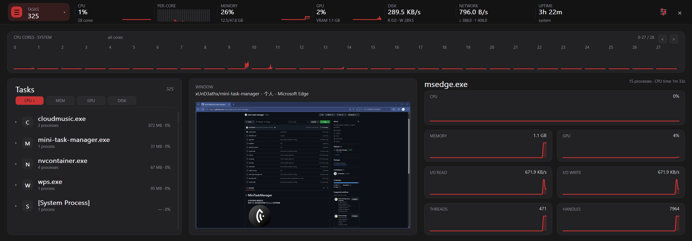

# MiniTaskManager
*此项目使用AI编程实现*  
使用 Odin 语言编写的简易 Windows 任务管理器  

## 技术简介
- 使用 Odin 语言编写
- 使用原生 Win32 API，使用 GDI 实现渲染
- 并使用了 Windows AppBar 实现顶部栏效果
## 截图

## 使用
打开 **mini-task-manager.exe** 即可使用
## 构建
- 生成图标（Pillow）
```
python make-icon.py
```
- 编译exe文件
```bat
build.bat
mini-task-manager.exe
```
## 配置
配置文件保存于 `%APPDATA%\MiniTaskManager\settings.ini`
